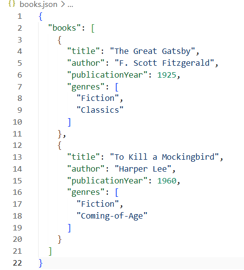
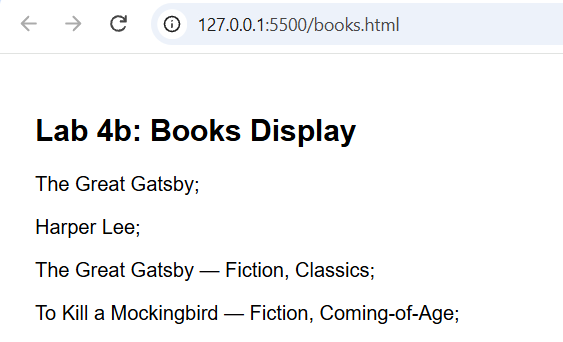
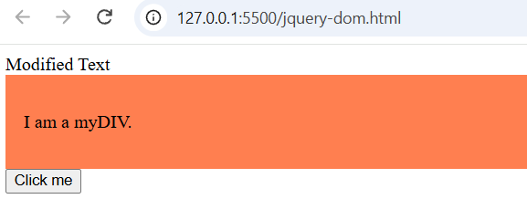

# BIC21203 Lab 4b: JSON and jQuery

This repository contains the files for Lab 4b, demonstrating how to fetch and parse JSON data using native JavaScript, and how to perform DOM manipulations using jQuery.

## Included Files
* `books.json`: The dataset containing book properties.
* `books.html`: Native JavaScript implementation using `fetch()`.
* `jquery-dom.html`: jQuery implementation for DOM updates and events.

## Setup Instructions
To run this project locally without encountering CORS errors:
1. Open this project folder in Visual Studio Code.
2. Install the **Live Server** extension by Ritwick Dey if you do not already have it.
3. Open `books.html` or `jquery-dom.html`.
4. Right-click anywhere in the editor and select **Open with Live Server** (or click "Go Live" in the bottom right corner).
5. The webpage will open in your default browser at `http://127.0.0.1:5500/`.

## Screenshots

**1. books.json Data Structure**

**2. Native Fetch Output (books.html)**

**3. jQuery DOM Operations (jquery-dom.html)**
